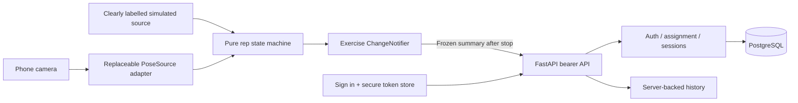

# Restora foundation decisions

Two independent repositories keep Flutter and FastAPI dependencies, CI and releases separate. The parent folder is a workspace, with no new repository initialized there. Developer A leads frontend and Developer B leads backend; both review and contribute across the boundary. Keep scope to one Android online demonstration and one exercise.

Flutter is organized by authentication, exercise and sessions, with screens, ChangeNotifier state, API repositories and platform services separate. The counting state machine has no camera, HTTP or widget dependency. PoseSource supplies angles or tracking-loss samples. It can be replaced without changing count or save semantics. Live camera/ML Kit and phone validation remain explicit Day 1-2 tasks until verified; simulation exercises integration only.

The backend is a single modular application. Routes handle HTTP/auth dependencies; Pydantic models validate; services implement ownership/idempotency; SQLAlchemy models and transaction boundaries persist to PostgreSQL. Alembic owns schema evolution. Do not add microservices, generic repository frameworks or job queues for this sprint.

Bearer tokens identify the owner; client-provided user IDs never grant access. Password hashes, signing secret and database credentials stay on the backend. The phone stores only its access token using secure platform storage and reauthenticates after expiry. Camera frames/landmarks stay on the phone. Session summaries contain identifiers, timestamps, completed repetitions, tracking mode and stop reason; there is no image upload endpoint.

Rep counting requires a full extended -> flexed -> extended cycle, stable threshold observations and reset after invalid/tracking-loss samples. Assignment movement thresholds and target are demonstration defaults requiring professional review before patient use. Counts are engineering feedback, not a clinical assessment.

Stop freezes one client-generated UUID and immutable summary. Retry always uses that payload, including after an ambiguous network result. The server enforces UUID uniqueness and compares all immutable input fields; identical requests return the same record, conflicts return 409. Cross-user UUID reuse never reveals the other user's record. Unsaved summaries live only in the open exercise screen; there is no local database or durable queue.

The backend's generated OpenAPI snapshot is authoritative. The frontend includes a reviewed copy plus the matching session example, consumed by tests. RST-001 approval here means the initial engineering baseline; both real developers still review the foundation PR. Additive contract changes and migrations deploy backend-first. The sprint plan distinguishes local scaffold checks from actual-phone and hosted MVP evidence.
